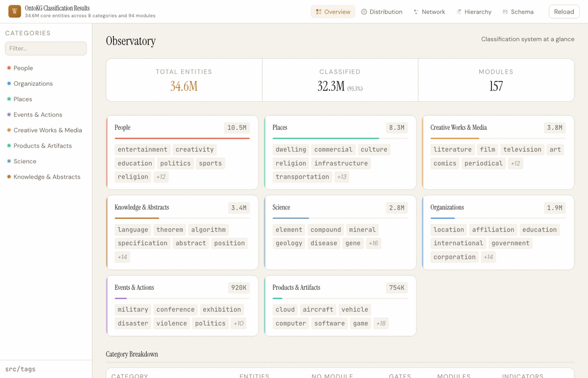

# OntoKG: Ontology-Oriented Knowledge Graph Construction with Intrinsic-Relational Routing

Reproducibility package for the paper *"OntoKG: Ontology-Oriented Knowledge Graph Construction with Intrinsic-Relational Routing"*.

This repository contains the complete pipeline for classifying Wikidata's 100M+ entities into 8 categories and 94 modules using declarative YAML schema definitions, and exporting the results as a typed property graph. The approach uses *intrinsic-relational routing* — classifying properties as either intrinsic (node attributes) or relational (graph edges) — to produce a declarative schema that is portable and reusable for downstream tasks.

## Overview

The pipeline has three stages:

1. **Bulk import detection** — Separates 34.6M human-curated core entities from 62M bulk-imported/infrastructure entities using signature-property matching against 19 source databases.
2. **Classification** — Assigns core entities to 8 categories and 94 modules (56 intrinsic + 38 relational) using declarative YAML tag definitions, achieving 93.3% classification coverage.
3. **Property graph export** — Produces CSV node and edge files for graph database import (34.0M nodes, 61.2M edges across 38 relationship types) and structured Parquet files for relational/document store loading.

Both Rust and Python implementations are provided. The Rust implementation processes ~110,000 entities/second on commodity hardware.

## Visualization

An interactive D3.js dashboard is included in `viz_core/` with five views: Overview, Distribution, Network, Hierarchy, and Schema.

<p align="center">
  
</p>

No dependencies required — just a local HTTP server (Python ships with one):

```bash
python3 -m http.server 8080
# Open http://localhost:8080/viz_core/
```

## Repository Structure

```
OntoKG/
├── src/
│   ├── tags/              # 8 declarative YAML category definitions
│   ├── bulk_import.yaml   # Bulk import detection rules (19 source databases)
│   ├── rust/              # High-performance Rust pipeline (classifier, exporter, LMDB builder)
│   └── python/            # Python implementation + analysis tools + demos
├── benchmarks/         # NER evaluation (AIDA-YAGO, CleanCoNLL) + entity disambiguation (BLINK)
├── data/               # Reference data (taxonomy, properties, examples)
└── viz_core/           # Interactive D3.js classification dashboard
```

## Data

Pre-built outputs (classified Parquet files, LMDB label store, Neo4j CSVs) are available on HuggingFace:

https://huggingface.co/datasets/yitao416/wikidata-schema-as-artifact

Some benchmark helpers also expect a prebuilt `data_dump_core_output/classified_with_sitelinks.parquet` artifact from that HuggingFace release for fast Wikipedia-title lookup.

To reproduce from scratch, you will need:

- **Wikidata dump**: Download from https://dumps.wikimedia.org/wikidatawiki/entities/ (`wikidata-*-all.json.gz` or split JSONL files)
- **LMDB label store**: Built from the dump using `build_lmdb` (maps QID/PID to English labels)

### Rust

- Rust toolchain (1.75+)
- Build: `cd src/rust && cargo build --release`

### Python

- Python 3.12+
- [uv](https://github.com/astral-sh/uv) (recommended) or pip
- Install: `cd src/python && uv sync` (or `pip install -e .`)

## Usage

All commands run from the project root.

### 1. Build the LMDB label store

Scans the full Wikidata dump and extracts English labels for all QIDs/PIDs (118.7M records, ~11 minutes).

```bash
./src/rust/target/release/build_lmdb
```

### 2. Filter core entities

Separates human-curated entities from bulk imports using signature-property matching.

```bash
# Detect bulk imports in a dump file
./src/rust/target/release/detect_bulk --file data_dump/wikidata-*.jsonl.zst

# Filter to keep only core-tier entities
./src/rust/target/release/filter_core
```

### 3. Classify entities

```bash
# Rust (~110K entities/sec, parallel processing, ~5 min for full dataset)
./src/rust/target/release/classify_dump

# Python (~10K entities/sec, single-threaded)
uv run --project src/python python src/python/classify_dump.py \
  --input data_dump_core/<file>.jsonl.zst \
  --output data_dump_core_output/classified_python/<shard>.parquet
```

### 4. Export property graph

```bash
# Export CSV files for neo4j-admin bulk import (~11 min)
./src/rust/target/release/export_neo4j
```

### 5. Validate YAML tags

```bash
./src/rust/target/release/tag_validator --gate-exclusive
# or
uv run --project src/python python src/python/tag_validator.py
```

### 6. Analysis tools

```bash
# P31 distribution analysis per category
uv run --project src/python python src/python/analyze_category_p31.py

# Find high-reference unclassified hub entities
uv run --project src/python python src/python/find_unclassified_hubs.py

# Query LMDB for entity/property labels
uv run --project src/python python src/python/query_lmdb.py Q42 P31
```

### 7. Run benchmarks

```bash
# AIDA-YAGO evaluation (94.7% classified, 93.1% aligned)
uv run --project src/python python benchmarks/aida_yago/eval_classification.py

# CleanCoNLL evaluation (93.9% classified, 97.8% aligned)
uv run --project src/python python benchmarks/cleanconll/eval_classification.py
```

### 8. Run demos

```bash
# Entity disambiguation via module fingerprints
uv run --project src/python python src/python/demos/disambiguate.py

# LLM-guided entity extraction from bundled sample passages
uv run --project src/python python src/python/demos/llm_extract_test.py --limit 5

# Property organization: raw Wikidata → structured view (live API)
uv run --project src/python python src/python/demos/property_organizer.py
```

The extraction demo reads `data/wiki_extracts.json` by default and writes results to `data_demos/` (created automatically). It requires `OPENAI_API_KEY`.

## YAML Tag Structure

Each category is defined in `src/tags/<category>.yaml`:

```yaml
gate_qids:              # QIDs that route entities into this category (via P31/P279)
  - Q5                  # human

core:
  props:                # Properties extracted for all entities in category
    - P21               # sex or gender

modules:
  entertainment:
    type: relational    # intrinsic (tabular data) or relational (graph edges)
    indicators:         # Matching criteria
      P345:             # Presence-based: entity has IMDb ID
      P31:              # Value-based: entity's P31 includes specific QIDs
        - Q11424        # film
    value_props:        # Additional properties extracted for this module
      - P136            # genre
```

**Module types:**
- **Intrinsic** — Properties inherent to the entity. Category-unique. Maps to tabular storage (e.g., PostgreSQL columns).
- **Relational** — Connections between entities. May span 2+ categories. Maps to graph edges (e.g., Neo4j relationships).

## Classified Output Schema

The classifier produces 13-column Parquet files:

| Column | Type | Description |
|--------|------|-------------|
| qid | VARCHAR | Wikidata entity ID |
| label | VARCHAR | English label |
| description | VARCHAR | English description |
| aliases | JSON | English aliases |
| p31_values | VARCHAR[] | Instance-of QID values |
| category | VARCHAR | Top-level category |
| intrinsic_modules | VARCHAR[] | Matched intrinsic modules |
| relational_modules | VARCHAR[] | Matched relational modules |
| gate_matched | VARCHAR | Gate QID that matched |
| gate_property | VARCHAR | Match property (P31 or P279) |
| matched_indicators | JSON | Module indicator matches |
| claims | JSON | Organized claims (core/intrinsic/relational/unclaimed) |
| sitelinks | JSON | Wikipedia sitelinks |

## Key Results

| Metric | Value |
|--------|-------|
| Wikidata entities processed | 100.9M |
| Core entities (after filtering) | 34.6M |
| Classification coverage | 93.3% (32.3M entities) |
| Module assignment rate | 98.0% (of classified) |
| Categories | 8 |
| Modules | 94 (56 intrinsic + 38 relational) |
| Neo4j nodes exported | 34.0M (32.3M classified + 1.7M stub) |
| Neo4j edges exported | 61.2M across 38 relationship types |
| AIDA-YAGO alignment | 93.1% |
| CleanCoNLL alignment | 97.8% |
| Rust throughput | ~110,000 entities/sec |

## License

Code is released under the [MIT License](LICENSE). Output data derived from Wikidata is subject to [CC0 1.0](https://creativecommons.org/publicdomain/zero/1.0/).
